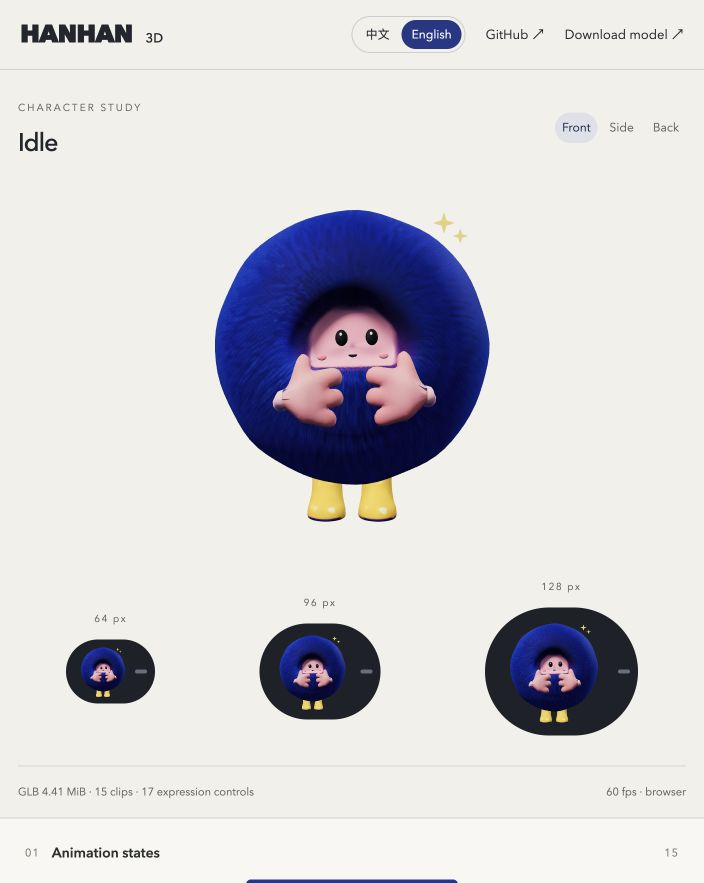

# Hanhan Model and Animation

[中文](README.md) · **English**

**Live preview: [GitHub Pages · English](https://purryc.github.io/hanhan-model-and-animation/?lang=en) · [中文](https://purryc.github.io/hanhan-model-and-animation/?lang=zh)**

Hanhan is a lightweight blue plush character with 15 state animations, curved eye and highlight motion, A/E/I/O/U mouth shapes, touch-triggered laughter, and secondary hair motion. It explores how a mobile agent can express its state in a top-of-screen or Dynamic Island-style overlay.



Use the Chinese / English switch at the top right. Switching language preserves the current animation and controls. The latest character asset is **v4.7**.

## Included

- [Mobile GLB](web/public/assets/hanhan_rodin_v4_7.glb), [state configuration](web/public/assets/hanhan_rodin_v4_7_states.json), and [editable Blender source](output/hanhan_rodin_v4_7.blend).
- A Three.js preview with 15 animation states, pointer gaze, simulated speech shapes, touch reactions and laughter, hair physics, optional props, and 64 / 96 / 128px views.
- A browser recorder that generates and downloads an animation reel locally. Speech shapes in the reel are simulated.
- Reproducible Blender scripts, the accepted T-pose source, standalone props, necessary original references and asset validation records.

## Animation states

| ID | State | Playback |
|---|---|---|
| `awaken` | Awakening | 2s, then idle |
| `idle` | Idle | 4s loop |
| `listen` | Listening | 3s loop |
| `think` | Thinking | 3s loop |
| `speak` | Speaking | 3s body loop, live mouth control |
| `briefing` | Briefing | 3s loop |
| `working` | Working | 2s loop |
| `progress` | Checking progress | 3s loop |
| `alert` | Alert | 2.4s loop |
| `review` | Reviewing | 3s loop |
| `decision` | Awaiting decision | 3s loop |
| `pause` | Paused | 4s seated loop |
| `resume` | Resuming | 2.4s, then working |
| `error` | Error | 3s loop |
| `playful` | Playful | 2.4s, then idle |

Transitions blend over 200ms by default. Closed, smiling and spiral eyes suppress ordinary gaze. Downward gaze is emphasized for placement near the top of a screen.

## Run locally

Use Node.js 22 or later.

```sh
git clone https://github.com/purryc/hanhan-model-and-animation.git
cd hanhan-model-and-animation/web
npm ci
npm test
npm run dev
```

Open the local URL printed in the terminal. For a production build:

```sh
VITE_BASE_PATH=/hanhan-model-and-animation/ npm run build
```

## Integration API

```js
window.hanhan.setState('speak');
window.hanhan.setGaze(0, -1);          // [-1, 1], x right, y up
window.hanhan.setSpeechLevel(0.7);     // volume envelope [0, 1]
window.hanhan.setViseme('A', 0.8);     // A/E/I/O/U label and strength
window.hanhan.setViseme(null);        // clear vowel shapes
window.hanhan.setActive(false);       // stop updates and rendering
```

For an independent integration, use `HanhanController` from `web/src/hanhan_controller.js`. Hair physics uses a few skinned guide regions with spring, damping and collision constraints. The companion `hair_physics.js` runtime runs the solver; a standalone GLB does not run physics or respond to a pointer automatically.

Volume drives mouth opening only. Vowel synchronization requires labels from the caller; the preview's vowel sequence does not recognize real speech.

## Rebuild the model

Use Blender 5.2 LTS. No paid generation service is required.

```sh
blender -b --python src/extend_gaze_v4_7.py
```

This rebuilds the latest asset from the packed v4.4 Blender source in this repository. To rebuild the complete rig from the accepted T-pose:

```sh
blender -b --python src/build_props_v4.py
blender -b --python src/build_animation_v4_4.py
blender -b --python src/extend_gaze_v4_7.py
```

## Resources and validation

The latest GLB is about **4.41 MiB** with 15 clips, 17 expression controls, 46 bones and textures up to 1024px. The character, current props and one state symbol fit within 20,000 triangles and 8 draw calls.

`npm test` checks the actual GLBs, loop seams, gaze/speech layering, interrupts, suspension and recovery, hair physics and language completeness. Source reopening and GLB round-trip evidence is in [qa/v4_7/asset_validation.json](qa/v4_7/asset_validation.json).

Android integration, device frame rate, battery use and overlay behavior still need real-device testing. Older GLBs are retained for regression tests and comparisons such as `?version=4.6`; the default preview uses v4.7. Large historical drafts from the original workspace are not all included in the public repository.

## Sources and rights

The character is reconstructed from user-supplied turnaround and state references. The base model was generated with Hyper3D Rodin; mesh refinement, rigging, props and animation were authored locally in Blender. Third-party audio sources and their CC0 license are listed in [CREDITS.md](CREDITS.md). No project-wide open-source license has been selected.

## Deployment

`.github/workflows/pages.yml` runs tests, builds the preview and deploys GitHub Pages on changes to `main`. The site supports `?lang=zh` and `?lang=en` and remembers the selected language.
