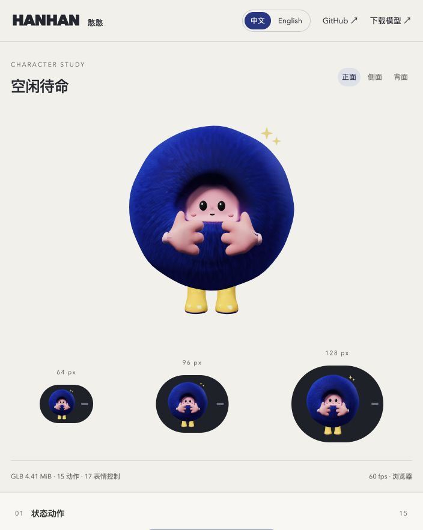

# Hanhan Model and Animation · 憨憨模型与动画

**中文** · [English](README.en.md)

**在线预览：[GitHub Pages · 中文](https://purryc.github.io/hanhan-model-and-animation/?lang=zh) · [English](https://purryc.github.io/hanhan-model-and-animation/?lang=en)**

轻量蓝色毛绒角色「憨憨」：15 种状态动画、曲面眼神与高光跟随、A/E/I/O/U 嘴型、触碰笑脸与笑声，以及随身体运动的毛层物理。用于探索移动端 Agent 在屏幕顶端或灵动岛式悬浮区域中的状态表达。



网页右上角可以切换中文 / English，语言切换保留正在播放的动作和控制设置。最新角色版本为 **v4.7**。

## 包含什么

- [移动端 GLB](web/public/assets/hanhan_rodin_v4_7.glb)、[状态配置](web/public/assets/hanhan_rodin_v4_7_states.json)和[可编辑 Blender 源文件](output/hanhan_rodin_v4_7.blend)。
- Three.js 交互预览：15 动作、指针注视、模拟语音嘴型、触碰逗趣与笑声、毛发物理、道具开关，以及 64 / 96 / 128px 检查。
- 本地浏览器生成并下载动画总览视频；录制的语音嘴型为模拟。
- 可重复执行的 Blender 构建脚本、T 型源模型、独立配件、必要原始参考和模型验证记录。

## 动作状态

| ID | 中文 | 播放 |
|---|---|---|
| `awaken` | 休眠唤醒 | 2 秒，转待机 |
| `idle` | 空闲待命 | 4 秒循环 |
| `listen` | 聆听中 | 3 秒循环 |
| `think` | 思考中 | 3 秒循环 |
| `speak` | 说话中 | 3 秒身体循环，实时嘴型 |
| `briefing` | 标题解释 | 3 秒循环 |
| `working` | 正在干活 | 2 秒循环 |
| `progress` | 查看进度 | 3 秒循环 |
| `alert` | 收到提醒 | 2.4 秒循环 |
| `review` | 检查结果 | 3 秒循环 |
| `decision` | 作出决定 | 3 秒循环 |
| `pause` | 我来处理 | 4 秒坐姿循环 |
| `resume` | 接着做 | 2.4 秒，转工作 |
| `error` | 错误异常 | 3 秒循环 |
| `playful` | 逗趣 | 2.4 秒，转待机 |

状态切换默认混合 200ms。闭眼、笑眼和螺旋眼会抑制普通眼神跟随。下视特别增强，以适应角色放在屏幕顶端的使用场景。

## 本地运行

需要 Node.js 22 或更新版本。

```sh
git clone https://github.com/purryc/hanhan-model-and-animation.git
cd hanhan-model-and-animation/web
npm ci
npm test
npm run dev
```

打开终端显示的本地地址。生产构建：

```sh
VITE_BASE_PATH=/hanhan-model-and-animation/ npm run build
```

## 接入接口

```js
window.hanhan.setState('speak');
window.hanhan.setGaze(0, -1);          // [-1, 1]，x 右、y 上
window.hanhan.setSpeechLevel(0.7);     // 音量包络 [0, 1]
window.hanhan.setViseme('A', 0.8);     // A/E/I/O/U 标签与强度
window.hanhan.setViseme(null);        // 清除元音口型
window.hanhan.setActive(false);       // 停止更新与渲染
```

独立调用方可直接使用 `web/src/hanhan_controller.js` 中的 `HanhanController`。毛发是少量蒙皮导向区的弹簧、阻尼和碰撞求解；配套 `hair_physics.js` 运行时负责物理，单独打开 GLB 不会自动执行物理或响应指针。

音量只驱动嘴部开合。元音同步需要调用方提供对应口型标签；预览中的元音轮播不能识别实际语音。

## 重建模型

使用 Blender 5.2 LTS。无需调用付费生成服务。

```sh
blender -b --python src/extend_gaze_v4_7.py
```

该命令从仓库中已打包贴图的 v4.4 基础源生成最新版本。若要从确认的 T 型重建整个绑定：

```sh
blender -b --python src/build_props_v4.py
blender -b --python src/build_animation_v4_4.py
blender -b --python src/extend_gaze_v4_7.py
```

## 资源与验证

最新 GLB 约 **4.41 MiB**，15 动作、17 表情控制、46 骨骼，纹理最大 1024px。角色及当前道具、一个状态符号不超过 20,000 三角面和 8 个绘制批次。

`npm test` 检查实际 GLB、循环接缝、眼神与嘴型分层、状态打断、暂停恢复、毛层物理及双语完整性。Blender 源文件重开、GLB 重导入证据见 [qa/v4_7/asset_validation.json](qa/v4_7/asset_validation.json)。

Android 接入、实际帧率、耗电和悬浮体验仍需后续真机验证。旧版 GLB 留作回归测试及 `?version=4.6` 等版本对比；最新展示使用 v4.7。原始工作目录中的大型历史草稿未全部纳入公开仓库。

## 来源与许可

角色依据用户提供的三视图和状态参考重建；基础模型来自 Hyper3D Rodin，后续网格修整、绑定、配件和动画在本地 Blender 制作。第三方音效的来源与 CC0 许可见 [CREDITS.md](CREDITS.md)。项目尚未设置统一的开源许可。

## 发布

`.github/workflows/pages.yml` 在 `main` 更新时运行测试、构建并部署 GitHub Pages。网页支持 `?lang=zh` 和 `?lang=en`，并记住用户的语言选择。
