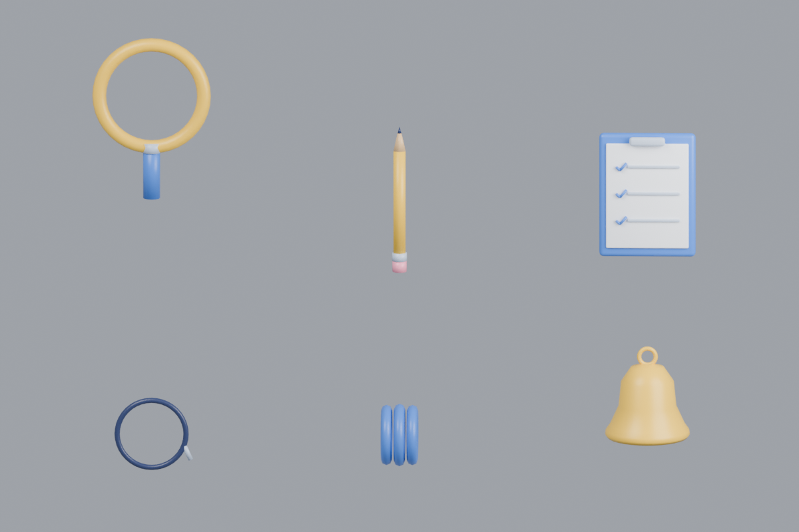

# 憨憨配件 v4

已本地构建 6 类配件，Rodin 额外费用为 0。原始参考清单见 `../../qa/v4/accessory_inventory.md`。

总览从左至右：上排放大镜、铅笔、夹板；下排单片眼镜、卷袖口、铃铛。

|配件|使用状态|三角面|GLB大小|
|---|---|---:|---:|
|[放大镜](magnifier.glb)|progress|728|25.8 KB|
|[铅笔](pencil.glb)|review|138|9.3 KB|
|[夹板](clipboard.glb)|review|1296|47.6 KB|
|[单片眼镜](monocle.glb)|review|684|23.4 KB|
|[卷袖口](rolled_cuff.glb)|resume|1920|60.2 KB|
|[铃铛](bell.glb)|alert|1632|51.1 KB|

每份 GLB 含单个网格、单个顶点色材质及独立的 `<name>_grip` 挂载空节点；没有外部贴图。卷袖口可实例化成左右两份，无需重复生成。所有物品在共用 `.blend` 文件内分开编辑，单独 GLB 的原点不带展示排版位移。

放大镜与单片眼镜采用开放镜孔，未增加透明玻璃和实时折射。它们是可用的几何配件；与最终憨憨手指的握持、袖口尺寸、面部遮挡还需在角色绑定时调整。

6 份 GLB 已重导入 Blender，检查挂载点、颜色属性、三角面与材质数量通过；已重新打开源文件并渲染背面。检查记录：`../../qa/v4/props_import_check.json`。

重建：在项目根目录运行 `Blender -b --python src/build_props_v4.py`。验证：`Blender -b --python src/verify_props_v4.py`。不调用外部生成服务。

状态图标由后续图形层处理。太阳、声波、三点、问号、进度条等不需要花 credit 建模。
